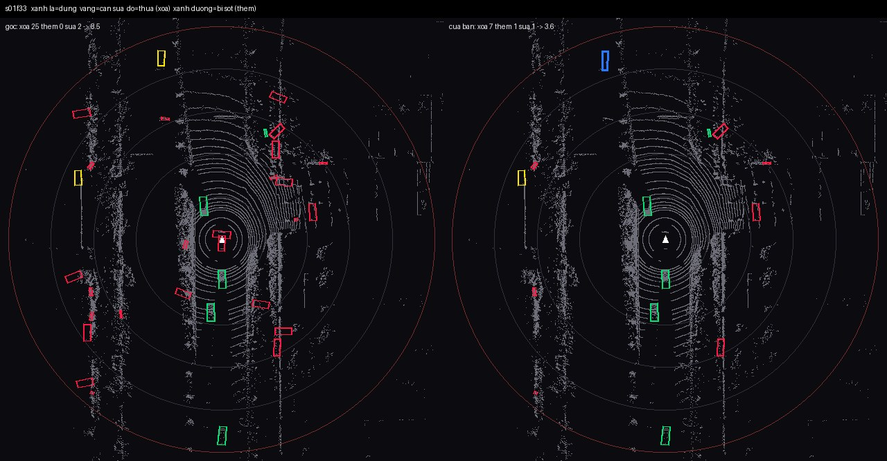

# Báo cáo Day 14 — Thạch Trung Đức — 2A202603141

- Mã học viên dùng với `--student`: `141`
- `seed_tag` trong `frames_A.txt`: `393590736f`

## 1. Dự đoán trước sweep (bước 5b)

Ghi **trước** khi chạy `scripts/pp_sweep.py`, rồi commit và push ngay (lịch sử commit là bằng chứng thời điểm viết). Không sửa phần này sau khi có kết quả.

- Tham số tôi nghĩ giảm công sửa nhiều nhất: `score_thr` (tăng ngưỡng tin cậy từ mức gốc `0.1` lên khoảng `0.3`–`0.4`).
- Vì sao (nhìn ảnh BEV tập A: box thừa nhiều hay box sót nhiều?): Quan sát ảnh BEV + 7 camera trong `d14_141/png_A/` và số đo cấu hình gốc ở bước 5 (`dự đoán 90`, `GT 25`, `xóa 66`, `thêm 1`, `sửa 2`, chi phí `21.8`), phần lớn công sửa đến từ **box thừa** (`66 × 0.3 = 19.8` điểm, chiếm hơn 90% tổng chi phí), chủ yếu là các box dự đoán nhầm vào bụi cây, dải phân cách, hàng rào và lề đường ở cả 3 frame (`s01f33` xóa 25, `s03f31` xóa 26, `s04f12` xóa 15), trong khi chỉ sót 1 box (xe `Bus` ở `s03f31` do model KITTI không học lớp Bus). Vì các box nhiễu ở hàng cây/lề đường thường có `score` thấp hơn xe thật, tăng `score_thr` sẽ loại được nhiều box thừa nhất; tuy nhiên không nên tăng quá cao (như `0.5`) vì mất 1 vật thể thật bị phạt `1.0` điểm, nặng hơn gấp hơn 3 lần xóa 1 box thừa (`0.3`). Còn `min_points` chỉ lọc thêm các box quá thưa điểm, khó lọc hết bụi cây dày điểm.

## 2. Tập A: sửa tay và tune

| Cấu hình | Xóa | Thêm | Sửa | Chi phí |
|---|---:|---:|---:|---:|
| Gốc | 66 | 1 | 2 | 21.8 |
| `best_config.json` | 20 | 2 | 1 | 8.5 |

- Tham số đã đổi trong `best_config.json`: `score_thr: 0.1 -> 0.4` (`min_points` giữ `0`; tại `score_thr=0.4`, cả ba mức `min_points=0, 5, 10` đều cho cùng chi phí `8.50` vì mọi box còn lại đều có ít nhất 10 điểm LiDAR).
- Kết quả leave-one-out (dán các dòng `scripts/pp_sweep.py` in ra):
  ```text
  Leave-one-out (chọn trên các frame còn lại, chấm trên frame bỏ ra):
    s01f33: cấu hình chọn {'score_thr': '0.4', 'min_points': '0'} → 3.6 (tốt nhất có thể 1.8)
    s03f31: cấu hình chọn {'score_thr': '0.5', 'min_points': '0'} → 4.2 (tốt nhất có thể 4.0)
    s04f12: cấu hình chọn {'score_thr': '0.5', 'min_points': '0'} → 2.6 (tốt nhất có thể 0.9)
  ```
- Cấu hình có ổn định trên từng frame không? Vì sao tôi vẫn chọn (hoặc không chọn) nó: Cấu hình **không hoàn toàn ổn định** trên 3 frame: ở 2/3 lượt leave-one-out (`s03f31`, `s04f12`) lưới chọn `score_thr=0.5`, còn lượt `s01f33` chọn `score_thr=0.4`, và chi phí trên frame bỏ ra chênh khá lớn so với mức tốt nhất có thể (`oracle`) ở `s01f33` (`3.6` so với `1.8`) và `s04f12` (`2.6` so với `0.9`). Dù tổng chi phí giữa `0.4` (`8.5`) và `0.5` (`8.6`) gần nhau, tôi vẫn chọn `score_thr=0.4, min_points=0` vì khi tăng lên `0.5`, số box bị sót (`thêm`) nhảy từ `2` lên `6` (đặc biệt gây hụt nhiều xe thật ở `s04f12`). Do mỗi box phải vẽ mới tốn `1.0` điểm và khó sửa hơn xóa box thừa (`0.3`), ngưỡng `0.4` và `min_points=0` ít rủi ro bỏ sót vật thể thật ở xa/ít điểm hơn khi áp dụng sang tập B.

## 3. Trước/sau (bước 8)



- `scripts/pp_compare.py` báo giảm **61%** công sửa trên tập A (`21.8 → 8.5`; theo từng frame: `s01f33` `8.5 → 3.6`, `s03f31` `8.8 → 4.0`, `s04f12` `4.5 → 0.9`). Lưu ý đây là mức giảm theo công thức trên chính 3 frame dùng để tune.
- Dự đoán ở mục 1 đúng hay sai? Giải thích bằng số box xóa/thêm/sửa: Dự đoán ở mục 1 **đúng về hướng chính**:
  - Tăng `score_thr` từ `0.1` lên `0.4` giảm mạnh số box cần xóa từ `66` xuống `20` (bớt `46` box thừa, giảm `13.8` điểm chi phí), là nguồn giảm chi phí chủ yếu.
  - Đúng như dự đoán, tăng `score_thr` lên `0.5` tuy giảm tiếp số box xóa xuống `7` nhưng làm số box bị sót (`thêm`) tăng từ `2` lên `6`, khiến tổng chi phí tăng ngược lên `8.6` do phạt thêm (`1.0`) nặng hơn xóa (`0.3`).
  - Tham số `min_points` chỉ giảm nhẹ chi phí khi `score_thr` còn thấp (`0.1`: `21.8 → 19.7` khi tăng lên `10`), và không tạo khác biệt tại `score_thr=0.4` (`8.5` cho cả `0, 5, 10`).
  - Điểm đánh đổi nhìn thấy rõ ngay trên ảnh `s01f33.jpg`: ở mức `0.4`, 1 xe ở xa (~44 m, khung vàng ở phía trên bên trái) bị lọc mất thành khung xanh dương bên phải, làm tổng `thêm` tăng từ `1` lên `2` (đồng thời `sửa` giảm từ `2` xuống `1`), và xe `Bus` bị sót ở `s03f31` vẫn không thể khắc phục bằng hậu xử lý.

## 4. Tập B

Số đo từ `scripts/pp_prelabel.py --frames d14_141/frames_B.txt --config d14_141/best_config.json --gt d14_141/ref_B.json`:

| Xóa | Thêm | Sửa | Chi phí |
|---:|---:|---:|---:|
| 96 | 18 | 14 | 53.8 |

- Tổng quan 12 frame tập B: `GT 147` (`125 Car`, `8 Truck`, `9 Cyclist`, `3 Bus`, `2 Pedestrian`), `dự đoán 225`, `khớp 129`; chi phí trung bình `4.48` điểm/frame (cao hơn mức `2.83` điểm/frame trên 3 frame tập A đã tune).
- Loại box tốn công sửa nhất ở tập B:
  - **Box nhiễu cần xóa (`96 × 0.3 = 28.8` điểm, ~53.5% tổng chi phí):** gồm `59 Car`, `31 Cyclist` và `6 Pedestrian` dự đoán thừa vào bụi rậm/bồn hoa (`s02f55`, `s05f02`), hàng cây/cột biển báo (`s01f43`, `s01f58`), hàng rào công trường (`s04f58`), xe hai bánh dựng bên đường không có người (`s02f13`) và box trùng xe ego ở tâm `(0, 0)`.
  - **`Cyclist` (`16.3` điểm: thêm `7` = `7.0` điểm + xóa `31` = `9.3` điểm):** model vừa bỏ sót nhiều người đi xe máy/xe đạp thật (`s01f04`, `s01f43`, `s02f37`, `s04f21`, `s04f58`, `s05f23`), vừa sinh nhiều box `Cyclist` thừa trên thân cây và cột.
  - **`Truck` và `Bus` (`9.0` điểm: thêm `4 Truck`, `3 Bus` = `7.0` điểm + sửa `4` hộp `Car→Truck` = `2.0` điểm):** do weights KITTI không học hai lớp này, xe tải thùng/xe van chở hàng/xe tải ben/xe buýt (`s01f04`, `s04f21`, `s04f39`, `s05f02`, `s05f45`) thường bị bỏ sót hoàn toàn hoặc chỉ được dự đoán thành một hộp `Car` nhỏ/lơ lửng cần đổi lớp và chỉnh lại toàn bộ kích thước, cao độ đáy và hướng.
- Ghi chú thao tác kiểm nhãn tập B: nhãn `d14_141/ref_B.json` được rà soát đối chiếu trực quan qua 7 góc camera + BEV (`scripts/vf_qa.py`), căn theo đám mây điểm LiDAR cho các vật bị sót/lệch và tự kiểm hình học bằng `vf_qa.check_frame` trên đủ 12 frame.

## 5. Giới hạn

- **Chỉ tune trên 3 frame (dễ overfit):** Kết quả leave-one-out cho thấy cấu hình tốt nhất dao động giữa `score_thr=0.4` và `0.5` và lệch khá xa `oracle` trên 2/3 frame, nên mức giảm `61%` công sửa trên tập A không thể mặc nhiên suy rộng sẽ giữ nguyên trên tập B hay dữ liệu mới.
- **Giới hạn miền dữ liệu của model KITTI:** PointPillars được huấn luyện trên KITTI (LiDAR 64 tia, chỉ góc nhìn phía trước, 3 lớp `Car`/`Cyclist`/`Pedestrian`), không học `Truck`/`Bus` (như xe `Bus` ở `s03f31` bị bỏ sót hoàn toàn) và dễ sót `Pedestrian`/`Cyclist` ở xa; việc chỉnh ngưỡng hậu xử lý không thể tự tạo lại vật thể model chưa dự đoán được.
- **Công thức chi phí chưa phản ánh thời gian gán nhãn thực tế:** Công thức `0.3·xóa + 1.0·thêm + 0.5·sửa` trong bán kính `50 m` chỉ là đại lượng quy ước để so sánh cấu hình, không tương đương số phút hay giờ công thực tế trên CVAT (ví dụ vẽ mới một xe lớn hoặc xoay ngược hướng 180° — vốn không bị tính vào `sửa` theo `needs_edit` — vẫn đòi hỏi người gán nhãn kiểm tra và chỉnh tay trên CVAT).
- **Nhãn tham chiếu có thể còn sai số chủ quan:** Chất lượng bước tune phụ thuộc trực tiếp vào độ chính xác của `ref_A.json` do người sửa tay trên CVAT (những vật bị che khuất, vật ở gần biên `50 m` hoặc box quanh xe ego đều ảnh hưởng tới số đo chi phí).
